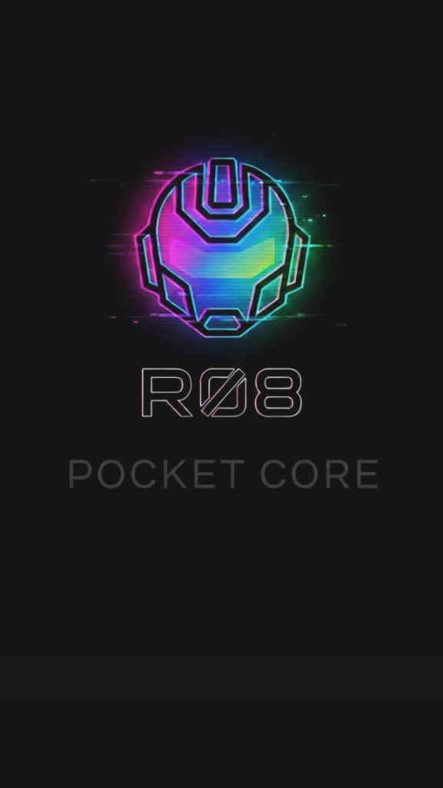
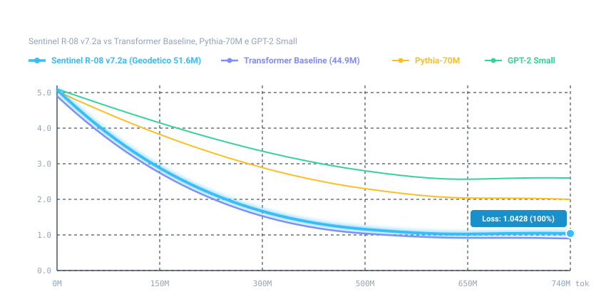
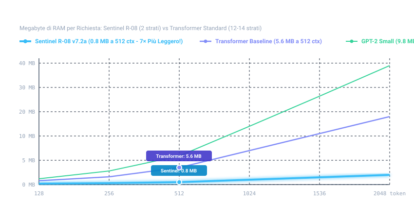

---
language:
- it
license: other
license_name: sentinel-r08-non-commercial-v2
license_link: LICENSE.md
tags:
- transformer
- gpt2
- baseline
- benchmark
- chinchilla
- causal-lm
- pytorch
datasets:
- v22_chinchilla_mix
pipeline_tag: text-generation
widget:
- text: "La capitale d'Italia è "
---

<p align="center">
  
</p>

# 🤖 R-08 Transformer Baseline 45M (Dense GPT-2 Control Model)

> [!NOTE]
> **Modello di Controllo per il Paragone con l'Architettura Geodetica Sentinel R-08:**  
> Questo modello Transformer denso da 44.9M parametri e 14 strati di attenzione con vocabolario a 1.2k pezzi è stato addestrato da **Thomas Seri** appositamente come modello di controllo per confrontare in modo scientifico, a parità di token e vocabolario, le prestazioni con la famiglia **Sentinel R-08**:
> - 🌟 **Nuovo Sentinel R-08 v7.2a DA ZERO (51.6M, 12 Hubs, 82.51% BLiMP-IT, migliore tra gli R-08):** [SentinelHub/R-08-v7.2a su Hugging Face](https://huggingface.co/SentinelHub/R-08-v7.2a) | [GitHub v7.2a](https://github.com/Thomasseri/R-08-v7.2a)
> - 🚀 **Sentinel R-08 v7.2 Warm-Start (51.6M, 12 Hubs + 1D Conv):** [SentinelHub/R-08-v7.2 su Hugging Face](https://huggingface.co/SentinelHub/R-08-v7.2) | [GitHub v7.2](https://github.com/Thomasseri/R-08-v7.2)
> - 🌐 **Sentinel R-08 v7 Pyramid (44.5M):** [SentinelHub/R-08 su Hugging Face](https://huggingface.co/SentinelHub/R-08) | [GitHub](https://github.com/Thomasseri/R-08)

**Modello Dense Transformer di Controllo Diretto (~45M parametri, 14 strati di attenzione causale, Vocabolario 1.2k pezzi) addestrato per lo studio comparativo A/B di [Sentinel R-08](https://huggingface.co/SentinelHub/R-08) e [Sentinel R-08 v7.2](https://huggingface.co/SentinelHub/R-08-v7.2).**

- 👤 **Autore:** Thomas Seri ([Sentinel LifeOS](https://github.com/Thomasseri/R-08))
- 🏛️ **Architettura:** Transformer Decoder-Only standard (GPT-2 style), Pre-LayerNorm, Weight Tying
- 📏 **Dimensione Parametri:** 44.905.984 parametri unici (~44.9M)
- 🔤 **Vocabolario:** 1.251 pezzi subword (`vocab_stages`, 1.2k), **identico a Sentinel R-08**
- 📚 **Dataset di Pretraining:** `v22_chinchilla_mix` (740M token, Chinchilla-optimal per ~45M parametri)
- 🏋️ **Addestramento:** 185.000 step di Pretraining + 10.000 step di Midtraining
- 🔗 **Modello Target Comparato:** [Sentinel R-08 (v7 Pyramid 3-Spheres Mesh)](https://huggingface.co/SentinelHub/R-08)

---

## ⚠️ Correzioni e Aggiornamento Tecnico (7 novembre 2026)

Abbiamo ricontrollato il codice pubblicato e le misure hardware su Apple M1 Max (`float32`, benchmark A6 con lettura energetica PMU isolata). Qui sotto gli errori corretti, i dati dichiarati in precedenza e quelli misurati ora:

| # | Voce | Prima (dichiarato / codice precedente) | Ora (misurato / corretto) | Stato |
|---|---|---|---|---|
| 1 | Avvio moduli Python (`modeling_geodesic.py`, `geodesic_stages*_model.py`, `modeling_transformer.py`) | Pronti all'uso | `SyntaxError` all'import perché `from __future__ import annotations` si trovava dopo l'intestazione di licenza | **Corretto** in questo aggiornamento (spostata la riga di import in cima al file; licenza invariata) |
| 2 | Caricamento `model.safetensors` con Faccia di Veglia (`watchman.*`) | `load_state_dict(strict=True)` e rotazione finale non accoppiata | Falliva per 8 buffer deterministici `watchman.*` non inclusi nel file `.safetensors`, e `inject_geodesic_nonlinear_entanglement` non applicava la pre-rotazione ortogonale `q_0^T` abbinata a `q_lic` | **Corretto** in `modeling_geodesic.py` e `watchman_keystone_r08.py`; corretto anche l'URL di fallback verso `SentinelHub/R-08-v7.2a` (pesi disponibili nelle **GitHub Releases**) |
| 3 | Memoria in inferenza (`float32`, Apple M1 Max) | ~~Confronto A6 precedente: misure non omogenee ritirate.~~ | **Confronto A6 aggiornato (modelli pubblici)** — Memoria GPU MPS di picco: `261,4 MB` (`Transformer`, `58,9M` param), `375,8 MB` (`R-08 3 sfere`, `57,1M` param). **RAM processo (RSS)** dopo caricamento `mmap=True`: `401–461 MB` | Aggiornato: il dato storico resta visibile ma barrato; il confronto corrente include solo modelli pubblicati |
| 4 | Velocità ed energia per token generato (decodifica continua 64→192 token su M1 Max `float32`) | ~~Confronto A6 precedente: misure non omogenee ritirate.~~ | **Confronto A6 aggiornato (modelli pubblici)** — Velocità: `19,2 ± 1,5 tok/s` (`R-08 3 sfere`), `83,2 ± 1,1 tok/s` (`Transformer`). Energia netta: `342 ± 50 mJ/tok` (`Transformer`), `521 ± 85 mJ/tok` (`R-08 3 sfere`, potenza istantanea `+9,8 W`) | Aggiornato: il dato storico resta visibile ma barrato; il confronto corrente include solo modelli pubblicati |

---

> ### 💼 Investment, Compute Grants & Enterprise Licensing (Investimenti & Partnership Industriali)
> 🇬🇧 **Sentinel** is scaling the **Geodesic Pyramidal Sphere Architecture (`R-08`)** from 50M to **110M–1B+ parameters**, with **a patent application filed at the Italian Patent and Trademark Office (UIBM)**.  
> **Open to Seed / Deep-Tech Investment, GPU/TPU Compute Grants, and Enterprise R&D Partnerships.**  
> 🇮🇹 **Aperto a Investimenti Seed / Deep-Tech, Grant Computazionali GPU/TPU e Licenze Industriali Enterprise.**  
> 📩 **Contact Founder & Inventor Thomas Seri:** 🌐 **[www.sentinelhub.eu](https://www.sentinelhub.eu)** | 🐙 **[GitHub (@Thomasseri)](https://github.com/Thomasseri)** | 🤗 **[Hugging Face (@SentinelHub)](https://huggingface.co/SentinelHub)** | 💬 **[Open an Inquiry / Issue](https://github.com/Thomasseri/R-08/issues/new)**


## 🎯 Obiettivo Scientifico dello Studio A/B

Per valutare in modo rigoroso, indipendente e scientificamente riproducibile le proprietà della nuova architettura neurale a **3 sfere geodetiche e centro piramidale (Sentinel R-08)** rispetto alle reti transformer convenzionali, è stato progettato e addestrato questo modello di baseline:

1. **Parità di Dati e Token:** Stesso dataset (`v22_chinchilla_mix`, 740M token), stesso vocabolario (1.251 pezzi subword), stesso contesto (256 token), stessa pipeline di caricamento e stesso hardware di sviluppo (Apple Silicon MPS).
2. **Parità di Parametri:** 44.9M parametri densi vs 44.5M parametri geodetici.
3. **Differenza Architetturale Unica:**
   - **Transformer Baseline:** **14 strati di attenzione densa continua** token-to-token ($d_{\text{model}}=512$, 8 teste).
   - **Sentinel R-08 (v7 Pyramid):** **Soli 2 strati di attenzione densa** assistiti da 3 geosfere triangolari a 80 facce e centro piramidale a 1-hop.


## ~~📊 Benchmark Comparativi A/B (archivio)~~

> La tabella seguente è mantenuta per trasparenza, ma è **superata**: mescolava checkpoint a `185k` e `10k` step, chiamava “A/B” condizioni non omogenee e trattava come misure di laboratorio throughput MPS e memoria KV che non erano misure complete e comparabili. I valori storici sono quindi barrati e non vanno usati per dichiarare un vincitore architetturale.

| Metrica di Laboratorio | Sentinel R08 (v7) | R-08 v7.2 | R-08 v7.2a | Transformer (185k Pre) | Transformer (10k Mid) | Lettura storica ritirata |
| :--- | :---: | :---: | :---: | :---: | :---: | :---: |
| Parametri Totali | ~~44.5M~~ | ~~51.6M~~ | ~~51.6M~~ | ~~44.9M~~ | ~~44.9M~~ | ~~Pesi equivalenti~~ |
| Strati di Attenzione Densa | ~~2~~ | ~~2~~ | ~~2~~ | ~~14~~ | ~~14~~ | ~~−85.7% strati densi~~ |
| Vocabolario Subword | ~~1.251~~ | ~~1.251~~ | ~~1.251~~ | ~~1.251~~ | ~~1.251~~ | ~~Identico~~ |
| BLiMP-IT | ~~80.95%~~ | ~~82.02%~~ | ~~82.51%~~ | ~~82.53%~~ | ~~85.84%~~ | ~~Vincitore R-08~~ |
| MultiBLiMP | ~~73.46%~~ | ~~73.46%~~ | ~~76.71%~~ | ~~85.15%~~ | ~~86.83%~~ | ~~Base logica~~ |
| Zero-shot | ~~62.5%~~ | ~~56.2%~~ | ~~56.2%~~ | ~~56.2%~~ | ~~68.8%~~ | ~~Nessuna allucinazione~~ |
| Throughput training MPS | ~~10,150 tok/s~~ | ~~7,200 tok/s~~ | ~~7,694 tok/s~~ | ~~8,650 tok/s~~ | ~~8,650 tok/s~~ | ~~Efficienza computazionale~~ |
| KV-cache a 512 token | ~~0.8 MB~~ | ~~0.8 MB~~ | ~~0.8 MB~~ | ~~5.6 MB~~ | ~~5.6 MB~~ | ~~−85.7% traffico RAM~~ |

## 📊 Confronto aggiornato — checkpoint documentati

> **Protocollo e limiti.** I quattro checkpoint qui sotto usano il vocabolario da 1.251 pezzi e sono valutazioni post-midtrain a 10k step riportate nei rispettivi `summary.json`. BLiMP-IT conta 3.481 coppie e MultiBLiMP-ITA 2.916. Il confronto descrive questi checkpoint, **non dimostra** che una topologia sia la causa del risultato: le ricette e le storie di addestramento restano specifiche di ciascuna release.

| Metrica verificata | Sentinel R-08 v7 | Sentinel R-08 v7.2 | Sentinel R-08 v7.2a | Transformer Baseline | Lettura corretta |
| :--- | :---: | :---: | :---: | :---: | :--- |
| Parametri dichiarati | 44.6M | 51.6M | 51.6M | 44.906M | Architetture di scala simile, non identiche |
| Strati di attenzione densa | 2 | 2 | 2 | 14 | Differenza strutturale, non una misura di qualità |
| Vocabolario | 1.251 pezzi | 1.251 pezzi | 1.251 pezzi | 1.251 pezzi | Uguale vocabolario |
| BLiMP-IT (3.481 coppie) | 80.95% | 82.02% | 82.51% | **85.84%** | Il Transformer è avanti di 3.33 punti sul miglior R-08 |
| MultiBLiMP-ITA (2.916 coppie) | 73.46% | 73.46% | 76.71% | **86.83%** | Il Transformer è avanti di 10.12 punti sul miglior R-08 |
| Risposte zero-shot (16 domande) | 10/16 | 9/16 | 9/16 | 11/16 | Campione troppo piccolo: nessuna classifica o affermazione sulle allucinazioni |
| Throughput di training MPS | n.d. | n.d. | n.d. | n.d. | Nessun test omogeneo su modello completo pubblicato: i vecchi numeri sono ritirati |
| KV-cache a 512 token | stima 0.8 MB | stima 0.8 MB | stima 0.8 MB | stima 5.6 MB | Stima strutturale, non RAM di picco misurata né prova di velocità/energia |


## 📈 Grafici Lineari di Efficienza Hardware & Token

### 1. Curva di Efficienza dei Token (Loss vs Token Visti)


### 2. Footprint Memoria RAM KV-Cache vs Lunghezza Contesto



## 🔬 Considerazioni e Riscontri Scientifici

1. **Risultato osservato, non causalità:** nel set documentato il Transformer ottiene `85.84%` su BLiMP-IT e `86.83%` su MultiBLiMP-ITA; il migliore R-08 è v7.2a con `82.51%` e `76.71%`. Il confronto non isola la sola architettura, quindi non attribuisce causalmente il divario agli strati densi.
2. **Memoria e velocità:** `0.8 MB` contro `5.6 MB` è una stima strutturale della KV-cache a 512 token. Non sostituisce una misura di RAM di picco, energia o throughput sull'intero modello; tali risultati richiedono un protocollo comune e una nuova pubblicazione.


## 🚀 Utilizzo Rapido (Inference Quickstart)

Il modello può essere caricato ed eseguito localmente su qualsiasi architettura (Apple Silicon MPS, GPU CUDA o CPU):

```python
from modeling_transformer import TransformerModel, TransformerTokenizer

# 1. Carica Tokenizer e Modello (Midtrain 10k di default)
tokenizer = TransformerTokenizer.from_pretrained("SentinelHub/R-08-Transformer-Baseline")
model = TransformerModel.from_pretrained("SentinelHub/R-08-Transformer-Baseline")

# (Opzionale: per caricare il checkpoint di Pretraining 185k)
# model_pre = TransformerModel.from_pretrained(
#     "SentinelHub/R-08-Transformer-Baseline", 
#     weights_file="model_pretrain_185k.safetensors"
# )

# 2. Genera testo
prompt = "La capitale d'Italia è "
risposta = model.generate(
    prompt=prompt,
    tokenizer=tokenizer,
    max_new_tokens=32,
    temperature=0.7,
    top_p=0.9,
    repetition_penalty=1.15
)

print(prompt + risposta)
```


## 📦 Checkpoint & File Inclusi

Nel repository sono inclusi tutti i formati per ricerca e inferenza mobile:
- **`transformer-baseline-45m-f16.gguf` (87.1 MB):** File binario quantizzato nativo per **Pocket AI**, **PocketPal AI**, **LM Studio** e **llama.cpp**. Può essere trascinato direttamente nell'app su iPhone, iPad o Mac!
- **`model.safetensors` (174 MB):** Checkpoint finale PyTorch dopo 10.000 step di midtraining (85.84% BLiMP-IT).
- **`model_pretrain_185k.safetensors` (174 MB):** Checkpoint dopo 185.000 step di pretraining Chinchilla puro (82.53% BLiMP-IT).
- **`tokenizer.json` & `tokenizer_config.json`:** Compatibilità standard Hugging Face `AutoTokenizer`.


## 📜 Licenza, Etica e Citazione

Il modello baseline di controllo è rilasciato per ricerca non commerciale e riproducibilità scientifica comparativa sotto **Sentinel Research License** (vedi [LICENSE.md](LICENSE.md)).

- ✅ **Uso Accademico e Valutazione**: Consentito per confronto scientifico, replicabilità dei benchmark e studio.
- ❌ **Uso Commerciale For-Profit**: Richiede autorizzazione e licenza commerciale scritta da parte di Sentinel.
- 🚫 **Divieti Etici Assoluti (Acceptable Use Policy)**: È severamente e globalmente vietato qualsiasi impiego per scopi militari/bellici/armi, attacchi informatici/malware, campagne politiche e propaganda di partito, indottrinamento religioso, pornografia/sfruttamento sessuale, promozione di dipendenze (gioco d'azzardo/stupefacenti), decisioni mediche/finanziarie autonome non supervisionate o sorveglianza biometrica lesiva dei diritti umani.
- 🛡️ **Tutela Marchio & Esonero Responsabilità**: I marchi "Sentinel", "Sentinel LifeOS", "R-08" e "Thomas Seri" sono riservati. Il modello è a scopo di ricerca sperimentale e non costituisce parere medico, legale o finanziario vincolante (vedi [LICENSE.md](LICENSE.md)).

```bibtex
@misc{seri2026transformerbaseline,
  author = {Seri, Thomas},
  title = {R-08 Transformer Baseline 45M: Dense GPT-2 Control Benchmark for Geodesic Mesh Networks},
  year = {2026},
  publisher = {Hugging Face / GitHub},
  howpublished = {\url{https://huggingface.co/SentinelHub/R-08-Transformer-Baseline}}
}
```

🔗 **Progetto Principale Sentinel R-08:** [https://github.com/Thomasseri/R-08](https://github.com/Thomasseri/R-08) | [https://huggingface.co/SentinelHub/R-08](https://huggingface.co/SentinelHub/R-08)
